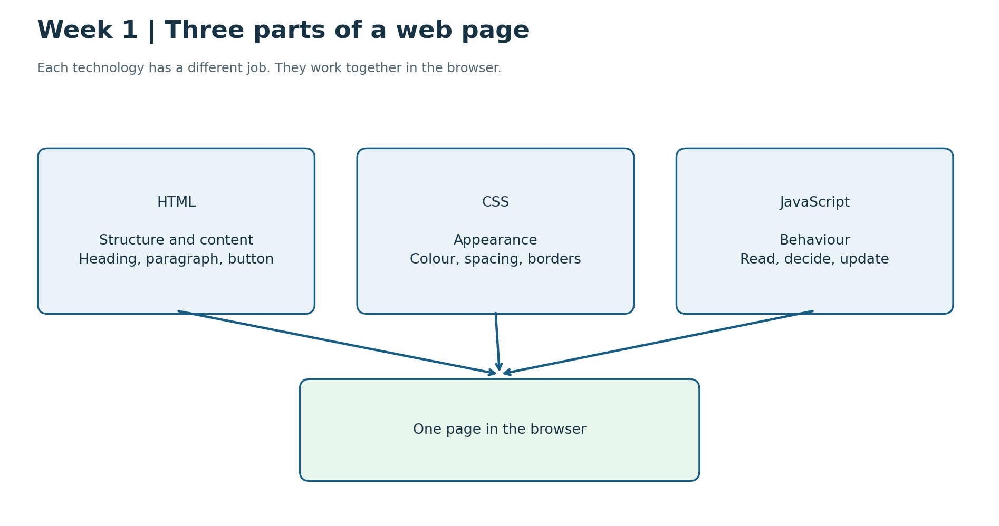
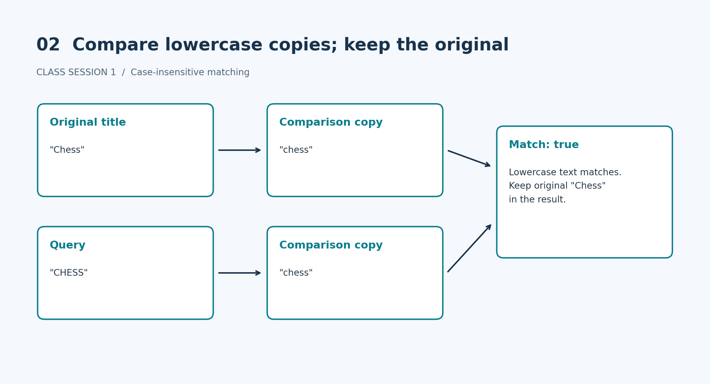
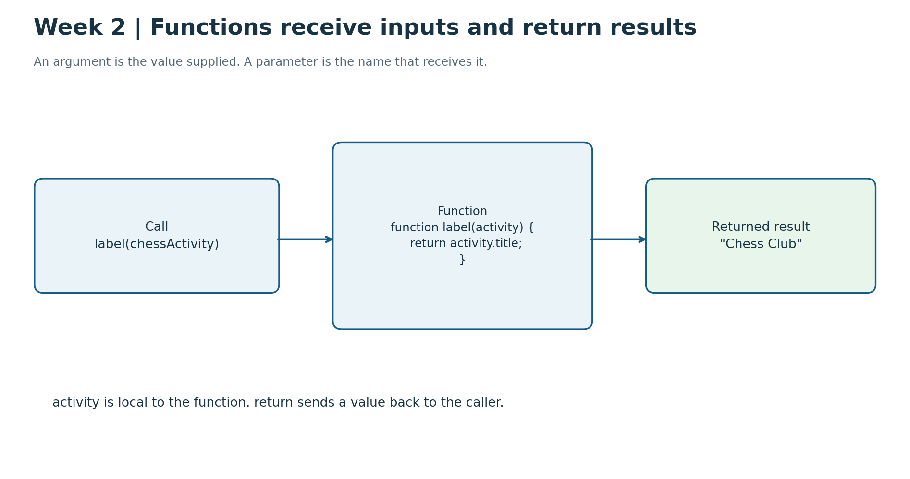
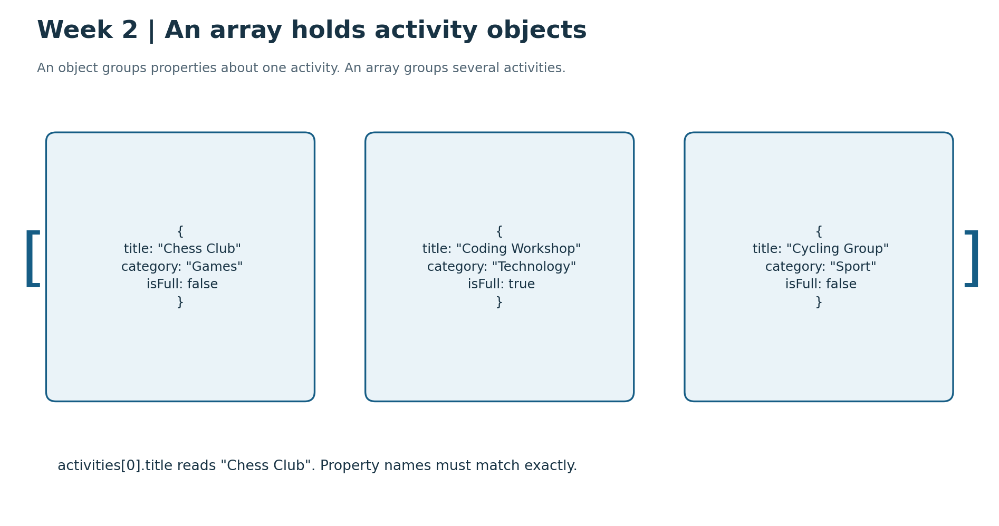
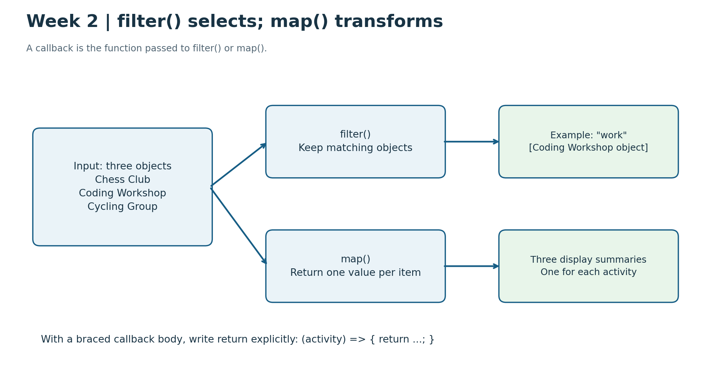
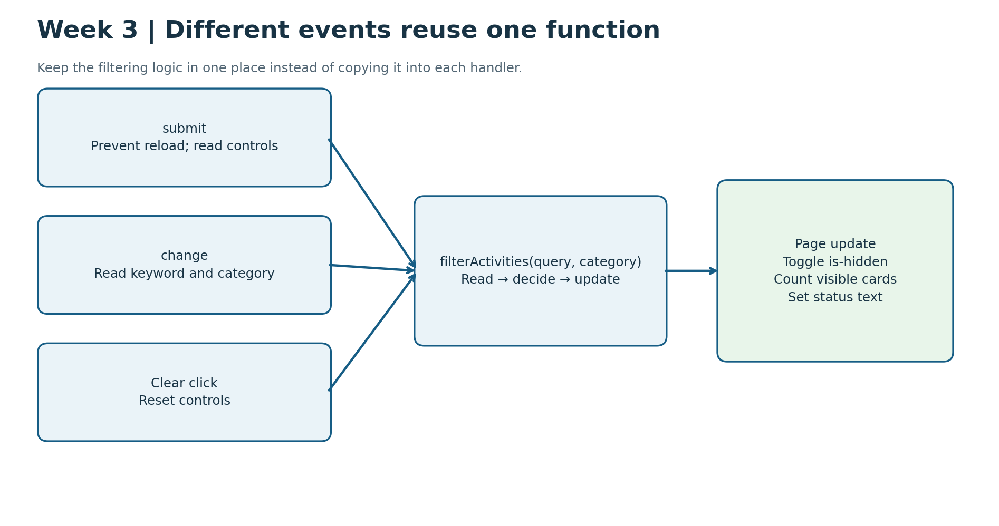
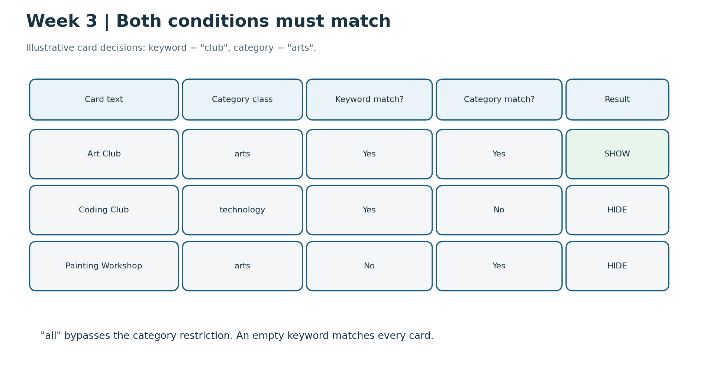
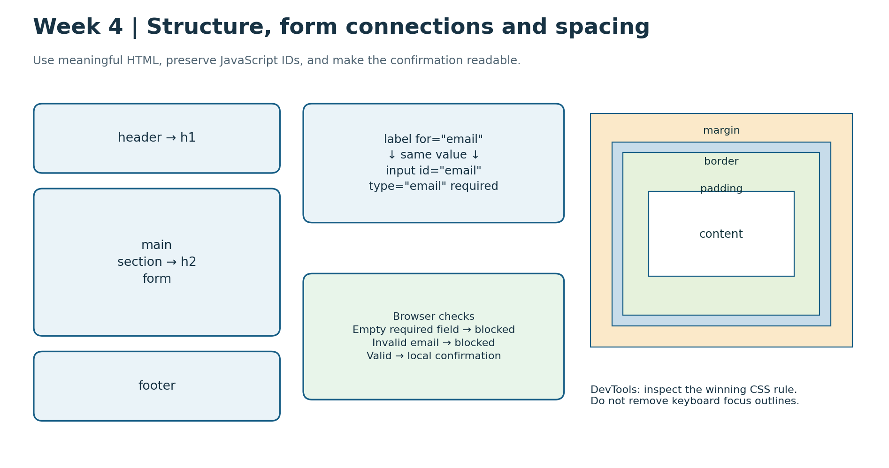

# Front-End Development: Weeks 1–4 Illustrated Guide

A beginner-friendly companion to the supplied lectures and practicals.

## How to use this guide

Read the diagram, follow the small example, then try the checks in your practical brief. This is a concept guide, not a complete set of submission solutions. Keep each week's files in a separate folder: some filenames repeat across weeks.

## The four-week journey

| Week | Main question | Practical |
|---|---|---|
| 1 | What do HTML, CSS and JavaScript do? | Activity Finder: foundations |
| 2 | How can functions process activity data? | Activity Finder: functions and structured data |
| 3 | How can a page respond to user actions? | Activity Directory |
| 4 | How can HTML and CSS make a form clearer and easier to use? | Campus Workshop Sign-up |

Weeks 1–2 share the Activity Finder context. Week 3 is an independent scenario. Week 4 is a separate sign-up page. Do not assume you must carry the same code forward for all four weeks.

## Week 1 — HTML, CSS and JavaScript foundations

### 1. Three technologies, three jobs



HTML describes content and structure. CSS controls how that content looks. JavaScript performs instructions, such as testing whether an activity matches a query.

```html
<h1>Find a Campus Activity</h1>
```

```css
h1 {
  color: navy;
}
```

```javascript
console.log("Ready to search");
```

What to notice: the heading and its colour appear on the page. The logged message appears in DevTools Console. Logging a result does not automatically update a paragraph on the page.

### 2. Case-insensitive matching



A case-insensitive comparison ignores differences between uppercase and lowercase letters. Make lowercase copies of both strings for the comparison; do not overwrite the activity titles.

```javascript
const title = "Chess";
const query = "CHESS";
const matches = title.toLowerCase().includes(query.toLowerCase());
console.log(matches); // true
console.log(title);   // "Chess"
```

`includes()` checks whether one string contains another. The empty string matches every title in this practical.

### Week 1 checks

| Query | Expected Console result |
|---|---|
| `"chess"` | `["Chess"]` |
| `"zzz"` | `[]` |
| `""` | `["Chess", "Coding", "Cycling"]` |

Change the heading and one visibly noticeable CSS declaration. Save and reload after each change. Complete the README explanations and help acknowledgement.

## Week 2 — Functions and structured data

### 3. Function inputs and returned results



A function is a named piece of reusable code. A parameter names an input inside the function. An argument is the actual value supplied in a call. `return` sends the result back.

```javascript
function label(activity) {
  return activity.title;
}

const chessActivity = { title: "Chess Club" };
const result = label(chessActivity);
console.log(result); // "Chess Club"
```

Here, `activity` is the parameter and `chessActivity` is the argument. The parameter name belongs to the function's scope: you cannot use that local name outside the function to access its input.

`console.log()` helps you inspect a value; it does not replace returning a result to the caller.

### 4. Objects inside an array



An object groups related properties about one thing. An array holds several items in order.

```javascript
const activities = [
  { title: "Chess Club", category: "Games", location: "Studio 2", isFull: false },
  { title: "Coding Workshop", category: "Technology", location: "Lab 4", isFull: true },
  { title: "Cycling Group", category: "Sport", location: "Sports Hall", isFull: false }
];

console.log(activities[0].title); // "Chess Club"
```

Array positions start at zero. `activities[0]` reads the first object. `.title` reads that object's title property. `isFull` is a Boolean: `true` or `false`, not a quoted word.

`const` prevents reassignment of the variable; it does not freeze an object's properties. Nevertheless, this practical's search should not deliberately change the supplied activity objects.

### 5. filter() versus map()



Use `filter()` to select items. Its callback returns a value that determines whether each item stays; the examples use `true` or `false`.

```javascript
const available = activities.filter((activity) => {
  return !activity.isFull;
});
```

`!` means “not”, so this selects activities that are not full. The result is a new array containing the selected original objects, not deep copies of them.

Use `map()` to prepare one result per item. Its callback's returned value becomes one element of the output array.

```javascript
const titles = activities.map((activity) => {
  return activity.title;
});
```

A callback is a function passed into another function to be called as part of its work. These two arrow-function forms both return a title:

```javascript
(activity) => { return activity.title; }
(activity) => activity.title
```

With braces, write `return` explicitly. Forgetting it in a `map()` callback often produces `undefined` entries.

### Week 2 practical connections

- Complete `searchActivities(items, query)` using case-insensitive title matching.
- Use the supplied `getStatus(activity)` helper.
- Complete `buildActivitySummaries(items)` so each summary has `title`, `details`, `statusText` and `statusClass`.
- Make status text agree with its CSS class.
- Update the static HTML card manually to represent Chess Club.

Creating summary objects does not automatically render them onto the page. DOM rendering and events are not required in this practical.

Check `CHESS`, `work`, `zzz`, an empty query and an empty input array. Check that three input activities produce three summaries. Explain your work in the README.

## Week 3 — DOM interaction and events

### 6. Select elements, then respond to events



The DOM is the browser's representation of the page that JavaScript can read and change. Select an element before trying to use it.

```javascript
const form = document.querySelector("#activity-form");
const cards = document.querySelectorAll(".activity-card");

console.log(form !== null); // should be true
console.log(cards.length);  // should be 8
```

`#` selects by ID; `.` selects by class. `querySelector()` returns one matching element or `null`. `querySelectorAll()` returns a NodeList, a collection of matching elements. Check its length, not whether it is null.

An event is something the page can respond to, such as form submission or a button click. An event handler is the function that runs in response.

The three required handlers reuse `filterActivities(query, category)`:

| Event | Handler responsibility |
|---|---|
| Form `submit` | Prevent reload, read the trimmed keyword and current category, then filter |
| Category `change` | Read the current controls, then filter |
| Clear button `click` | Reset keyword to `""` and category to `"all"`, then filter |

Keep the decision logic in the shared function rather than copying it into every handler.

### 7. Keyword AND category



The cards in the diagram are illustrative, not an inventory of the eight starter cards.

```javascript
const matchesKeyword = card.textContent.toLowerCase().includes(query.toLowerCase());
const matchesCategory = category === "all" || card.classList.contains(category);
const shouldShow = matchesKeyword && matchesCategory;

card.classList.toggle("is-hidden", !shouldShow);
```

- `||` means OR: “all” is selected, or the card has the selected category class.
- `&&` means AND: both the keyword and category conditions must be true.
- `!shouldShow` reverses the decision: add the hiding class when the card should not show.

Use this logic inside `forEach()` to work through the cards. Count the visible cards and update the status using `textContent`. Use `1 activity found` for one result and `activities found` otherwise.

### Week 3 checks

1. Empty keyword and All categories: eight cards and matching status.
2. Matching keyword: only matching cards.
3. No-match keyword such as `zzz`: no cards and zero results.
4. Category only: only that category.
5. Keyword and category together: both conditions apply.
6. Clear: both controls reset and all eight cards return.

Edit only `app.js` for the core practical. The HTML and CSS are prepared. Live filtering, Escape-to-clear and adding a card are optional extensions, not substitutes for the core checks.

## Week 4 — Semantic HTML, forms and CSS

### 8. Structure, connections and the box model



Semantic HTML uses elements that describe the role of the content. For this practical, use one main `h1` and logical section `h2` headings.

```html
<header>
  <h1>Campus Workshop Sign-up</h1>
</header>
<main>
  <section>
    <h2>Choose your workshop</h2>
    <!-- Place the prepared form here. -->
  </section>
</main>
<footer>Campus workshop information</footer>
```

This is a structural illustration, not a replacement for the supplied page. Preserve the existing form and the JavaScript connections.

### 9. Labels and browser validation

A visible label's `for` value must match its control's `id`.

```html
<label for="email">Email</label>
<input id="email" name="email" type="email" required>

<label for="workshop">Workshop</label>
<select id="workshop" name="workshop" required>
  <option value="">Choose a workshop</option>
  <option value="example">Example workshop</option>
</select>
```

The example workshop option is illustrative; keep the supplied choices in your practical.

- `id` identifies the control and connects the label and prepared JavaScript.
- `name` names the form field.
- `type="email"` asks the browser to check email-format input; it does not prove that the address exists.
- `required` blocks submission when a required value is missing.
- The prompt's empty value prevents it from counting as a valid workshop selection.

Keep `workshop-form`, `full-name`, `email`, `workshop` and `status`. The prepared JavaScript depends on these IDs. Use fictional information only. This practical sends and stores nothing.

### 10. Content, padding, border and margin

Read the nested boxes in the diagram from inside outward:

| Area | Meaning | Example purpose |
|---|---|---|
| Content | The text or control content | The visible words |
| Padding | Space inside the border | Stop text touching its border |
| Border | The line around the padded content | Define the field boundary |
| Margin | Space outside the border | Separate neighbouring field groups |

```css
.field {
  padding: 0.75rem;
  border: 1px solid #777;
  margin-bottom: 1rem;
}
```

This is a teaching example, not a claim that the starter contains a `.field` class. Apply changes to selectors that match your HTML. Change one property at a time and inspect the result.

### 11. Diagnose the unreadable status message

Do not guess which CSS declaration is responsible:

1. Complete valid fictional details and submit so the success state appears.
2. Inspect the status element in DevTools.
3. Find the applied colour/background declarations and rules that are crossed out.
4. Identify the winning declaration and explain why it wins.
5. Fix the cause and submit again to verify readable text.

Which rule wins depends on the competing rules, not simply which one is last. Record the actual declaration from your starter; this guide does not invent the culprit. Keep the built-in keyboard focus indicator: do not remove outlines.

### Week 4 checks and evidence

Record all ten required checks in `checks.md`: structure, labels, empty required fields, invalid email, unselected workshop, valid local confirmation, Tab and Enter, changed workshop and resubmission, winning CSS declaration, and spacing.

In `README.md`, explain structure, form connections, the CSS conflict, spacing decisions and assistance received. Read but do not rewrite the prepared JavaScript for core work.

## A debugging routine for every week

1. Make one small change.
2. Save, reload and read the Console.
3. For DOM work, check the selected element and collection length.
4. Check that the handler runs and reads the expected values.
5. Check the decision before changing the page.
6. Inspect the actual class, text and CSS rule.
7. Compare the result with the required check.
8. Record what happened rather than assuming it passed.

## Submission reminders

| Week | Required submission |
|---|---|
| 1 | Completed `index.html` and `README.txt`; before Lesson 2 |
| 2 | Follow the practical/Brightspace submission instructions; before Lesson 3 |
| 3 | Completed `app.js` with supplied `index.html` and `styles.css`; follow Brightspace instructions |
| 4 | `index.html`, `styles.css`, `app.js`, `README.md`, `checks.md`; before Lesson 5 |

Confirm exact deadlines and submission formats in Brightspace. Acknowledge help, including AI, where requested. Be able to explain the work you submit. Completing a practical is evidence of practice, not proof that every concept has been mastered.

## Source materials

Based on the supplied Week 1 Activity Finder brief; Week 2 Activity Finder brief and Functions and Data Quick Reference; Week 3 Activity Directory brief; and Week 4 Campus Workshop Sign-up brief. The diagrams and small illustrative examples were created for this companion guide. The original briefs remain authoritative for task scope and submission requirements.
