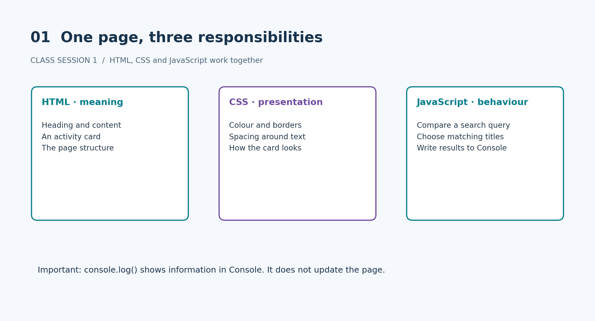
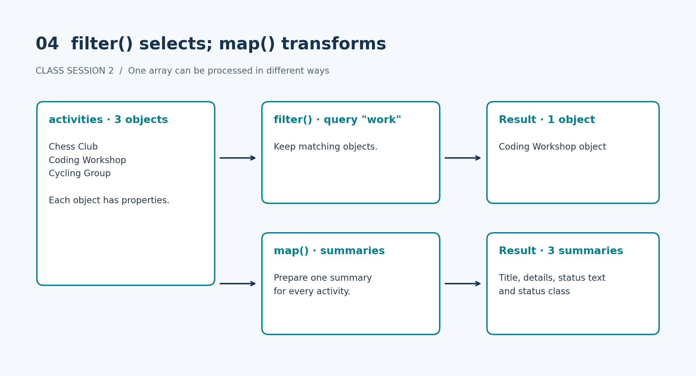
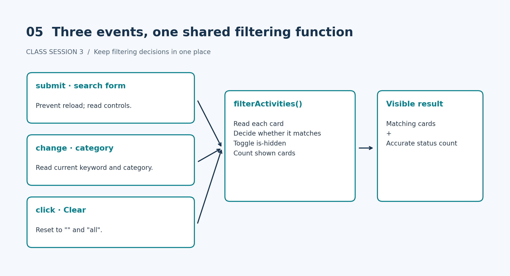
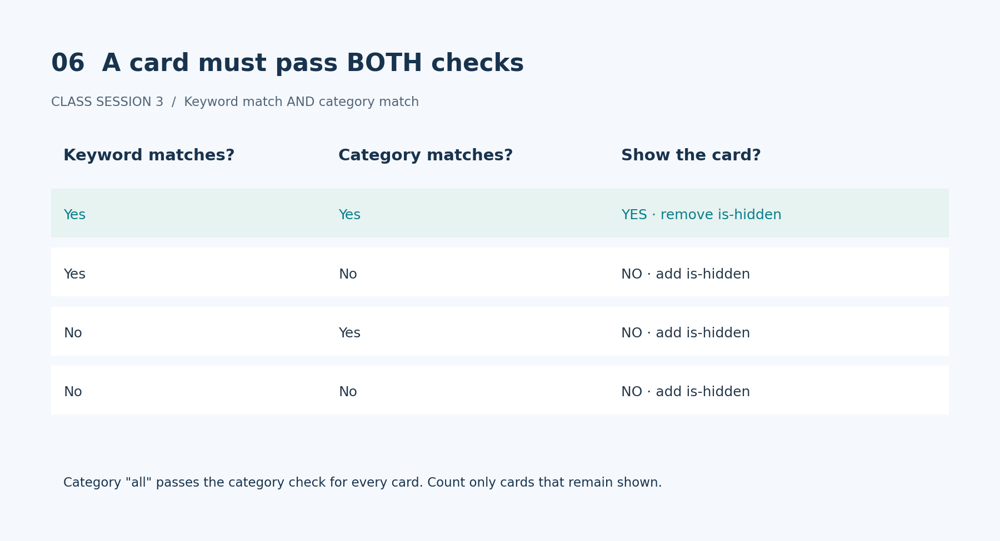
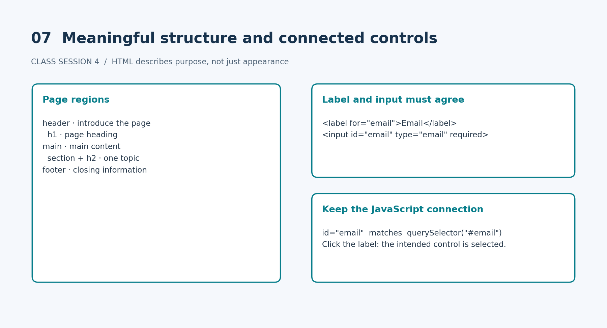
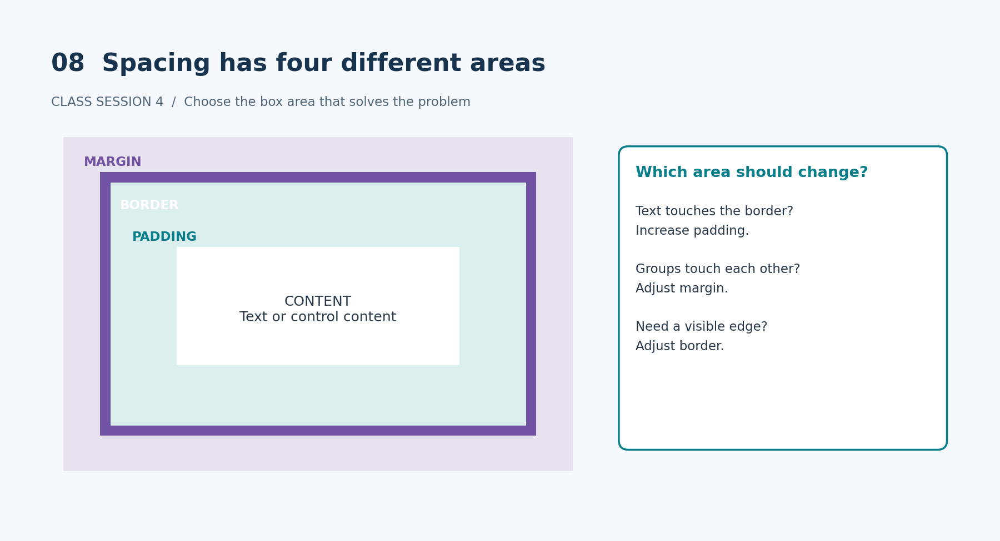
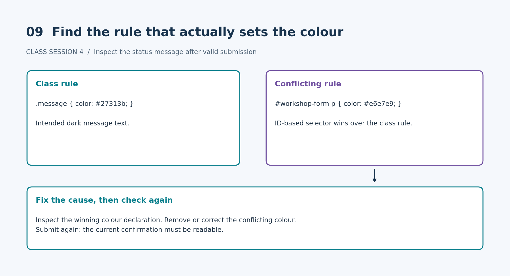

# Front-End Development: Class Sessions 1–4

A combined beginner guide based only on the supplied lecture notes, practical briefs, quick reference and starter materials.

## How to use this guide

These are class sessions. Work through one session at a time. Read the explanation, trace the example, make the required changes, and run every check. The diagrams are teaching illustrations of the supplied concepts, not screenshots of completed applications.

Sessions 1–2 use Activity Finder. Session 3 uses an independent Activity Directory. Session 4 uses Campus Workshop Sign-up. You do not have to turn all four practicals into one application.

Edit source files, save and reload to check changes. Console experiments are temporary. Explain, verify and acknowledge any AI help. Check Brightspace for exact submission instructions.

## Class Session 1 — HTML, CSS and JavaScript foundations

### 1.1 One page, three responsibilities



- HTML gives content structure and meaning. A heading names content; an article groups related content.
- CSS controls presentation, including colour, spacing and borders.
- JavaScript can add custom behaviour, such as testing whether a title matches a query.

A Console result is not a page update. console.log() displays information in the browser Console. The Session 1 static paragraph does not automatically change when a matching array is logged.

### 1.2 Make matching case-insensitive


A query is the text you search for. Normalising means putting the compared text into a consistent form. Here, convert both the title and query to lowercase for comparison.

```js
title.toLowerCase().includes(query.toLowerCase())
```

Read this from left to right: make a lowercase version of the title, then check whether it contains a lowercase version of the query. Keep the original title in the matching result. Do not replace the stored title with lowercase text merely to search it.

### 1.3 Read basic JavaScript carefully

These small examples appear in the supplied lecture:

```js
"2" + 1           // "21"
Number("2") + 1   // 3
"2" === 2         // false
"2" == 2          // true
```

Convert deliberately and prefer strict equality (===) in this lesson. Check an array's length to find out whether it is empty. An empty JavaScript array is truthy, so testing the array itself does not test whether it contains results.

```js
if (titles.length === 0) {
  console.log("No results");
}
```

### 1.4 Activity Finder practical

1. Change the visible heading to something meaningful.
2. Change one CSS declaration with an obvious visual effect.
3. Correct matching so both compared strings are normalised.
4. Save and reload for each check.
5. Explain the changes and any AI assistance in README.txt.

| Query | Expected Console result |
|---|---|
| "chess" | ["Chess"] |
| "zzz" | [] |
| "" | ["Chess", "Coding", "Cycling"] |

Submit index.html and README.txt before Class Session 2, subject to the exact Brightspace deadline. Adding a fourth activity is optional after the core work.

Sources: Lesson 01 lecture; Lesson 01 practical brief; Lesson 01 README.

## Class Session 2 — Functions and structured data

### 2.1 Pass inputs in and return results out


```js
function matchesTitle(title, query) {
  return title.toLowerCase().includes(query.toLowerCase());
}
const result = matchesTitle("Chess", "CHESS");
console.log(result); // true
```

- A function groups reusable steps.
- Parameters are the names in its definition: title and query.
- Arguments are values supplied at the call: "Chess" and "CHESS".
- return sends the result to the caller.
- console.log() displays information; it does not replace return.

Scope describes where a variable name can be used. A variable declared inside a function cannot be accessed by that name outside it. Its value can leave through return. A function may read enclosing variables, but parameters make required inputs visible.

### 2.2 One object describes one activity

```js
const activity = {
  title: "Chess Club",
  category: "Games",
  location: "Studio 2",
  isFull: false
};
```

An object groups related properties. activity.title reads the title property. An array holds several activity objects. The supplied set contains Chess Club, Coding Workshop and Cycling Group.

The data has an interface purpose:

| Property | Display purpose |
|---|---|
| title | Card heading |
| category and location | Supporting details |
| isFull | Interpreted as Available or Full |
| Derived status class | status-available or status-full |

Users should see meaningful status text, not the raw Boolean false. Use the supplied getStatus(activity) helper to keep the status text and CSS class consistent.

### 2.3 filter() and map() do different jobs



A callback is a function another operation calls. filter() and map() call a callback once per activity.

- filter(): Which items should remain? Its callback returns a test; the result is a new array containing selected objects.
- map(): What should every item become? Each callback result becomes an element in the new array.

With a braced arrow-function body, write return explicitly:

```js
(activity) => {
  return activity.title;
}
```

The expression-body form returns implicitly:

```js
(activity) => activity.title
```

Missing return can cause a filter to keep nothing or a map to produce undefined values.

### 2.4 const does not freeze contents

```js
const activity = { isFull: false };
activity.isFull = true; // allowed
// activity = {};      // reassignment error
```

const prevents reassignment of the variable, not changes to object properties or array contents. Two variables can also refer to the same object; changing that shared object is visible through either reference. For this practical, search should return matching original objects without deliberately changing them.

### 2.5 Activity Finder practical

1. Inspect the activity properties.
2. Complete searchActivities(items, query) using filter() and case-insensitive title matching.
3. Use getStatus(activity).
4. Complete buildActivitySummaries(items) using map(). Each summary needs title, details, statusText and statusClass.
5. Manually update the static HTML card to represent Chess Club.
6. Run the checks and explain the functions in README.txt.

| Check | Expected result |
|---|---|
| CHESS | Chess Club object |
| work | Coding Workshop object |
| zzz | [] |
| Empty query | All three objects |
| Empty items array | [] |
| Summaries | Three summary objects; status text and class agree |

This session does not require DOM rendering or event handlers. Preparing a summary object does not automatically update HTML. Submit before Class Session 3 according to Brightspace.

Sources: Lesson 02 lecture, quick reference, practical brief and starter JavaScript.

## Class Session 3 — DOM interaction and events

### 3.1 Select the page elements first

The DOM is the browser's live page structure. JavaScript can read and change its elements. HTML is the source; the DOM is the current structure in memory.

```js
const form = document.querySelector("#activity-form");
const cards = document.querySelectorAll(".activity-card");
```

querySelector() returns one matching element or null. querySelectorAll() returns a NodeList, a collection of selected elements. An empty NodeList has length 0; it is not null.

Verify before continuing:

| Element | Selector | Expected check |
|---|---|---|
| Form | #activity-form | Reference is not null |
| Keyword input | #keyword | Reference is not null |
| Category select | #category | Reference is not null |
| Clear button | #clear | Reference is not null |
| Status | #status | Reference is not null |
| Cards | .activity-card | length is 8 |

The starter loads app.js with defer so the elements exist when the code runs. If a reference is null, check both the selector spelling and when the script runs.

### 3.2 Keep one decision-and-update path



Follow the supplied interaction model:

Select → iterate → listen → read → decide → update → check.

An event is an action the page can respond to. A listener connects an event name to a handler function. The handler runs when that event occurs.

| Event | Element | Handler responsibility |
|---|---|---|
| submit | Form | Prevent reload; read the trimmed keyword and selected category; call the shared function |
| change | Category select | Read current values; call the shared function |
| click | Clear button | Reset keyword to "" and category to "all"; call the shared function |

Read controls with .value. Read the text inside a card with .textContent. trim() removes spaces at the start and end of a string.

### 3.3 Both keyword and category must match



The supplied cards carry both activity-card and a category class, such as arts. Option values match those category class names.

Inside filterActivities(query, category):

1. Start the visible count at zero.
2. Use forEach() to process one card at a time.
3. Compare lowercase card text with the lowercase query.
4. Check the category class with classList.contains(category). The category "all" matches every card.
5. Show the card only if keyword AND category match.
6. Toggle is-hidden on non-matching cards and count those left shown.
7. Set the status with textContent. Use "1 activity found" for one result and the plural for other counts.

The supplied CSS makes .activity-card.is-hidden use display: none. JavaScript chooses the state; CSS controls how that state appears.

### 3.4 Activity Directory practical checks

Edit app.js only for the core practical. Leave supplied HTML and CSS unchanged.

| Check | Expected result |
|---|---|
| Empty keyword + All categories, then Search | All 8 cards; "8 activities found" |
| Keyword club | Only cards containing club |
| Keyword zzz | No cards; status reports 0 |
| Empty keyword + Arts | Only Arts cards |
| Keyword club + Arts | Only cards matching both |
| Clear | Empty keyword, All categories, all 8 cards |

For every check, shown cards and status text must agree. Debug in order: references → collection length → handler → current values → condition → class/text update → visible result.

Optional only after all six checks pass: live filtering with input; Escape-to-clear with keydown; or create and append a card. If a card is added after the original selection, select the cards again inside the filtering function so the new card is included.

Submit app.js together with index.html and styles.css according to Brightspace instructions.

Sources: Lesson 03 lecture, Activity Directory brief and supplied CSS.

## Class Session 4 — Semantic HTML, forms and CSS

### 4.1 Structure describes purpose



Semantic HTML chooses elements by purpose:

- header introduces the page.
- main contains its main content.
- section groups one topic, normally with a heading.
- article is a complete piece that makes sense on its own.
- div is suitable for a general group when no more meaningful element fits.
- footer holds closing information.

For this practical, use one h1 for the page and an h2 for each section. Choose heading levels for hierarchy, not font size. CSS changes appearance; making a paragraph large does not give it heading meaning.

### 4.2 Connect labels, controls and JavaScript

```html
<label for="email">Email</label>
<input id="email" name="email" type="email" required>
```

The label's for value matches the control's id. Clicking the label should select the intended control. Give each control a suitable name and type. Make Full name, Email and Workshop required. The workshop prompt must have an empty value so it does not count as a valid choice.

Keep these supplied IDs unchanged:

workshop-form, full-name, email, workshop, status.

The prepared JavaScript selects them. Read app.js, but do not rewrite it for the core tasks. Leave the browser's focus indicator intact; do not remove outlines.

### 4.3 Choose the correct spacing area



- Content: the text or control content.
- Padding: space between content and border.
- Border: the visible edge around the padding and content.
- Margin: space outside the border.

If text touches a border, adjust padding. If field groups touch each other, adjust margin. If a button is cramped inside, adjust its padding. Change one property at a time and explain the visible effect.

### 4.4 Diagnose the actual CSS conflict



The starter includes:

```css
.message {
  color: #27313b;
}

#workshop-form p {
  color: #e6e7e9;
}
```

Both rules can match the status paragraph. In these supplied rules, the ID-based selector is more specific, so its pale colour wins over .message. The .message.is-success rule adds font weight; it does not supply a replacement colour in the starter.

After valid submission, inspect the status element in DevTools. Find the winning colour declaration and fix the conflicting cause. Removing or correcting the unwanted pale colour is a direct way to address it. Submit again and verify the message is readable. Explain which declaration won and why, not just that the text now looks better.

### 4.5 Campus Workshop Sign-up practical checks

Use fictional details only. The prepared code gives a local confirmation; nothing is sent or stored. This is not a real booking service.

| Action | Expected result |
|---|---|
| Read regions and headings | Meaningful structure and hierarchy |
| Click every visible label | Intended control selected |
| Submit required fields empty | Browser blocks submission |
| Enter alex as email | Email-format check rejects it |
| Complete other fields but keep workshop prompt | Empty workshop choice rejected |
| Submit valid fictional details | Readable local confirmation |
| Use Tab and Enter | Controls reachable in order; Enter submits |
| Change workshop and submit again | One current message reflects new choice |
| Inspect fixed status rule | Readable text; winning declaration explained |
| Inspect field spacing | Name the box area changed and explain why |

Record what actually happened in checks.md. Browser wording varies: check whether the rule is enforced, not its exact message.

In README.md, explain structure, form connections, the CSS conflict, spacing decisions and help received. Submit index.html, styles.css, app.js, README.md and checks.md before Class Session 5, following Brightspace instructions.

Optional after core completion: add an information section and justify its heading, compare padding/border combinations, or adapt the prepared code to show a workshop description.

Sources: Lesson 04 lecture, Campus Workshop Sign-up brief, supplied CSS and JavaScript, README and checks template.

## Final review — keep these distinctions clear

| Do not confuse | Key difference |
|---|---|
| Console result / page update | Logging does not itself change the DOM |
| return / console.log() | Send a result to caller / display information |
| filter() / map() | Select items / transform items |
| const / frozen contents | No reassignment / contents can still change |
| One selected element / NodeList | Check null / inspect length and iterate |
| Keyword OR category / keyword AND category | The directory requires both tests to pass |
| Heading level / visual size | HTML hierarchy / CSS appearance |
| Padding / margin | Inside the border / outside the border |
| Local confirmation / actual registration | No information is sent or stored in Session 4 |

Finish the required checks before optional challenges. Be ready to explain the work you submit, verify any AI assistance and acknowledge help.

## Uploaded material used

- FED_Lesson_01_HTML_CSS_JavaScript_Foundations.pdf
- FED_Lesson_02_JavaScript_Functions_and_Data_Modelling-2.pdf
- FED_Lesson_03_DOM_Interaction_and_Events-3.pdf
- FED_Lesson_04_Semantic_HTML_Forms_CSS-4.pdf
- FED_L01_Activity_Finder_Practical_Brief.docx and Session 1 README
- FED_L02_Functions_and_Data_Quick_Reference-2.pdf
- FED_L02_Activity_Finder_Practical_Brief-3.docx and Session 2 starter JavaScript
- FED_L03_Practical_Brief_Activity_Directory-4.docx and Session 3 CSS
- W4_Practical_Brief-6.docx and Session 4 CSS, JavaScript, README and checks template

All diagrams were newly drawn to explain these supplied concepts. No external sources or additional course topics were used.
